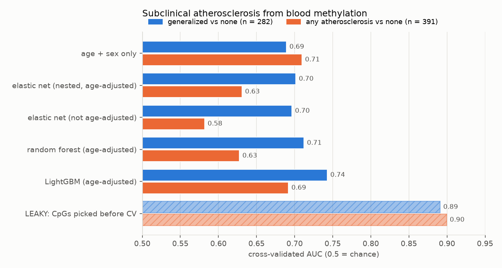
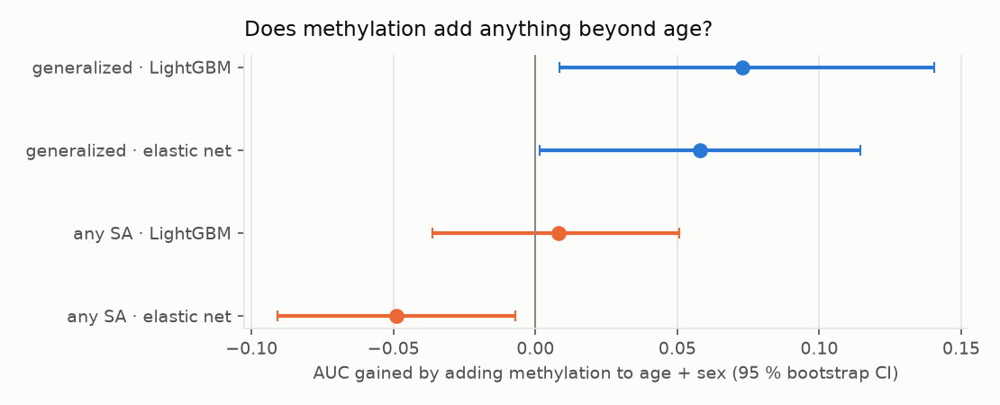

# methylation-cvd

**Can blood DNA methylation detect subclinical atherosclerosis beyond what age already tells you, and what does it
take to run such a model responsibly in a lab?**

An end-to-end, leakage-safe ML pipeline on real public data: **GEO GSE220622**, Illumina EPIC arrays (818k CpGs) on
whole blood from 391 middle-aged participants of the PESA study, each graded for subclinical atherosclerosis by vascular
imaging (none, focal, intermediate, generalized). It goes from streaming ingestion and lab-style QC through repeated
nested cross-validation to an **MLflow**-tracked, registry-served model, with batch drift monitoring, a hold-and-
renormalise protocol, and a gated champion/challenger feedback loop.

> Research demo on public, de-identified data. Not a medical device; not for clinical use.

## Findings



<!-- gen:models -->
| model | generalized vs none (282) | any atherosclerosis vs none (391) |
|---|---|---|
| age + sex only | 0.689 ± 0.004 | 0.710 ± 0.002 |
| elastic net (nested, age-adjusted) | 0.701 ± 0.017 | 0.631 ± 0.006 |
| elastic net (not age-adjusted) | 0.697 ± 0.010 | 0.582 ± 0.027 |
| random forest (age-adjusted) | 0.712 ± 0.009 | 0.627 ± 0.011 |
| LightGBM (age-adjusted) | 0.743 ± 0.012 | 0.692 ± 0.007 |
| **LEAKY: CpGs picked before CV** | 0.891 ± 0.006 | 0.900 ± 0.016 |

Label-permutation null (elastic net, 50 shuffles): mean AUC 0.49 / 0.51, 95th percentile 0.59 / 0.59; observed beats every shuffle (p = 0.02, the smallest possible with 50).
<!-- /gen:models -->



<!-- gen:incremental -->
| target · model | methylation only (age-adjusted, no age/sex input) | age + sex | age + sex + methylation | gain [95 % CI] | p (one-sided) |
|---|---|---|---|---|---|
| generalized · LightGBM | 0.71 | 0.69 | 0.74 | **+0.073** [+0.008, +0.141] | 0.015 |
| generalized · elastic net | 0.65 | 0.69 | 0.72 | **+0.058** [+0.002, +0.115] | 0.023 |
| any atherosclerosis · LightGBM | 0.62 | 0.71 | 0.69 | **+0.008** [-0.036, +0.051] | 0.351 |
| any atherosclerosis · elastic net | 0.50 | 0.71 | 0.63 | **-0.049** [-0.091, -0.007] | 0.988 |
<!-- /gen:incremental -->

1. **Picking CpGs before cross-validation turns a weak signal into a fake diagnostic.** Selecting the 1,000
   most-different CpGs on all samples and then cross-validating reports **AUC 0.89–0.90**. Doing the same selection
   inside each training fold gives 0.63–0.74. With 800k features and 300 samples, the leaky version mostly measures
   how well noise can be fitted, and it's the most common way omics models get overstated.
2. **Age is the confounder to beat.** The design matched cases and controls on age, sex and traditional risk factors,
   but this public subset isn't perfectly matched: the generalized group is 2.6 years older on average. **Age and sex
   alone reach AUC 0.69–0.71**, and methylation changes strongly with age. Every methylation model here regresses
   each CpG on age and sex inside the training fold before selecting features, so any signal it finds is beyond age.
3. **For extensive disease there is a real but modest methylation signal.** Methylation alone, age-adjusted and
   without age or sex as inputs, reaches AUC 0.71 (LightGBM). Adding it to age + sex gains **+0.073 AUC**
   [+0.008, +0.141] for LightGBM and +0.058 [+0.002, +0.115] for the elastic net. Two model families agree, and the
   label-permutation null sits at 0.49 (95th percentile 0.59).
4. **For mild or focal disease there's no usable signal.** Including focal and intermediate disease ("any
   atherosclerosis"), methylation adds nothing to age + sex (+0.008, CI crosses zero), and the elastic net makes it
   significantly *worse* (−0.049). Hundreds of CpGs with no extra signal dilute a strong age effect. The honest
   product claim from this data is narrow: a small improvement in flagging *extensive* subclinical disease.

## Pipeline

```
GEO matrices (685 MB M-values, 2.6 GB signals) ──stream──▶ float32 memmap (818k × 391) + parquet sheets + manifest
     │                                                      (one pass; detection-p failure rates counted on the fly)
     ▼
QC: autosomal out-of-fold sex check (swap detection) · drop SNP-overlapping and non-CpG probes (−10,164)
     ▼
inside each training fold:  top-100k variance → per-CpG OLS on age/sex (residualise) → top-k Welch t → model
     ▼                      (elastic net nested over k and C · random forest · LightGBM), repeated 5-fold CV
MLflow: every run's params, metrics, out-of-fold predictions, data hash → registry  pesa-sa-classifier @champion
     ▼
serving (FastAPI, loads @champion) · batch drift monitor · hold → renormalise → recheck · feedback → challenger → gated promotion
```

### Lab QC

- **Sample identity.** Both public matrices had their X/Y probes removed, so the usual chrX/chrY sex check isn't
  possible. Sex is instead predicted **out of fold from autosomal CpGs**: AUC 1.00, with no sample's recorded sex
  contradicted. This is weaker than an X/Y check, and with the raw IDATs (5.9 GB) one would use the sex chromosomes
  directly.
- **Probe filtering.** Probes whose target or extension base sits on a common SNP (manifest `SNP_DISTANCE ≤ 1`, MAF
  ≥ 1 %) are dropped, because their "methylation" partly measures genotype; so are non-CpG probes.
- **Genotype data.** This GEO series publishes no genotypes; even the array's own SNP control probes are missing from
  the processed files. The pipeline is genotype-aware (SNP-probe filtering) but has no genotype features. The
  company's published test combines methylation with SNP genotypes, which would need the raw IDATs or a genotyping
  assay.

## Running it in production

The production simulation (`scripts/simulate_production.py`) holds out 40 % of samples and streams them as four
28-sample lab batches, labels arriving one batch late. Batch 2 gets a realistic **reagent-lot artifact**: Infinium
type-II probes shifted +0.35 and compressed ×0.9.

<!-- gen:production -->
| step | what the monitor saw | action |
|---|---|---|
| register v7 as @champion | trained on 169 samples | — |
| batch 1 | MMD p = 0.336; 0 / 1040 model CpGs shifted; 4 / 29 outlier samples | released |
| batch 2 (**injected reagent-lot artefact**) | MMD p = 0.003; 660 / 1040 model CpGs shifted; 27 / 28 outlier samples | HOLD: drift detected, results not released; batch re-normalised and re-checked → after: MMD p = 0.16, 3 CpGs shifted, released |
| batch 3 | MMD p = 0.472; 0 / 1040 model CpGs shifted; 2 / 28 outlier samples | released |
| batch 4 | MMD p = 0.003; 0 / 1040 model CpGs shifted; 2 / 28 outlier samples | released with a warning: MMD drift alone (no model-CpG shift, few outliers); logged for review |
| challenger v8 (launch data + 85 feedback labels) | AUC on batch 4: champion 0.83, challenger 0.85; difference +0.02 [-0.13, +0.18] | **not promoted**: 28 labelled samples cannot show it is not worse |

Drift calibration (40 clean and 40 artefact batches of 28 held-out samples): hold rate 2.5 % on clean batches, 100 % on artefact batches.
<!-- /gen:production -->

What the monitor does (`mcvd/drift.py`):

- **Per sample:** Mahalanobis distance in the training PCA space.
- **Per batch:** kernel MMD against the training reference (permutation p-value), and KS tests with BH-FDR on the
  model's CpGs.
- **Predictions:** score PSI.
- **Performance:** AUC on whatever labeled feedback has arrived.

Results are held only on **two independent signals**: MMD drift *and* either ≥ 5 % of the model's CpGs shifted or
≥ 25 % outlier samples.

Three bugs the build surfaced, each now covered by a test or a calibration run:

- **In-sample PCA reference.** Comparing new batches with the *training samples' own* PCA projections flagged
  perfectly clean batches, because in-sample scores are inflated. The PCA is now fit on half the reference and the
  other half is the comparison set.
- **In-sample score reference.** Score PSI against in-sample predictions was 4.5 on a clean batch. The reference is
  now out-of-fold predictions. Even so, PSI over 10 bins is too noisy at n = 28 to alarm on, so it's reported but
  isn't a hold criterion.
- **Re-normalization.** The first version rescaled to the median of per-probe spreads, far narrower than the pooled
  spread, and made every model CpG look shifted. It now matches the batch's pooled type-I/type-II distributions to
  the training set's pooled distributions, which inverts an affine artifact like this one.

The promotion gate is deliberately conservative. A challenger trained on 85 extra labels scored higher on the next
batch (0.85 vs 0.83), but 28 samples give a confidence interval from −0.13 to +0.18, so it was **not** promoted. In a
CLIA setting, promotion would also be a documented change-control event with a validation report, not an automatic
alias move.

### MLflow

- **Experiments:** `pesa-<task>`, one run per configuration, logging parameters, AUC mean/SD, out-of-fold
  predictions, and the source-data hash.
- **Registry:** `pesa-sa-classifier`. Each version carries the git SHA, the data hash and an intended-use tag;
  aliases `@champion` / `@challenger` are the deployment contract.
- **Model contract.** The pyfunc model enforces its own input checks: it rejects samples missing more than 5 % of its
  2,000 CpGs (imputing up to that), and rejects **beta values sent where M-values are expected**, the most common unit
  mistake with methylation data. The MLflow signature declares CpGs as optional doubles; an inferred signature had
  made all 2,000 required and float32, so MLflow rejected JSON input before the model's own checks could run.

### Service

`serve/app.py` (FastAPI) loads `@champion` and scores batches of samples, returning risk, missing-CpG count and a
QC error per sample. A live test scored a complete sample, imputed one missing 50 CpGs, and rejected both a
beta-valued sample and one missing 20 % of CpGs. The **audit log** stores a SHA-256 of each request, the model version
and a timestamp: no methylation values, no identifiers beyond the caller's own opaque reference.

AWS deployment design (S3/KMS, MLflow on ECS with RDS + S3, ECS/SageMaker serving, EventBridge monitoring job,
HIPAA-minded defaults) is in [deploy/AWS.md](deploy/AWS.md). It's a design, not applied from this repo.

## Run it

```bash
python -m venv .venv && .venv/bin/pip install -r requirements.txt
./scripts/fix_libomp_macos.sh /path/to/libomp.dylib   # macOS without Homebrew (LightGBM needs OpenMP)
make data ingest qc         # ~3.5 GB download; ingest streams it in ~2 minutes into a 1.3 GB memmap
make experiments            # ~40 min on an M4 laptop
.venv/bin/python scripts/incremental.py generalized_vs_none
make production             # registers models, runs the batch lifecycle
make ui                     # MLflow UI: runs, registry, aliases
make serve
```

## Limitations

- **One cohort, 282–391 people, mostly men (93 %), aged 40–55.** No external validation, so the +0.06–0.07 AUC gain
  is an internal estimate with a wide interval. It would need replication in an independent cohort, ideally with
  incident cardiovascular events rather than imaging grades.
- **Blood cell composition isn't adjusted for.** Whole-blood methylation partly reflects the mix of cell types, which
  can track inflammation and atherosclerosis. Part of the signal may be cell composition, not a vascular signature.
  A reference-based deconvolution is the next step.
- **No genotypes** (see above), so the "multi-omic" model here is methylation + age + sex.
- **Elastic-net tuning capped at 3,000 CpGs** (10,000-CpG fits took 10–30 s each with saga), and the permutation null
  uses 50 shuffles (minimum p = 0.02).
- **The production simulation uses a synthetic artifact** on real samples, and 28-sample batches; real batch effects
  are messier and slide-specific.
